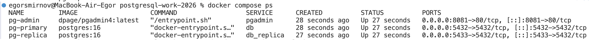
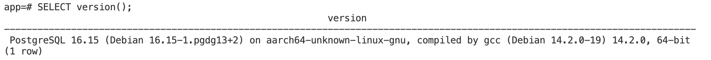
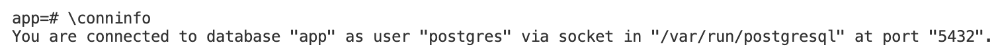
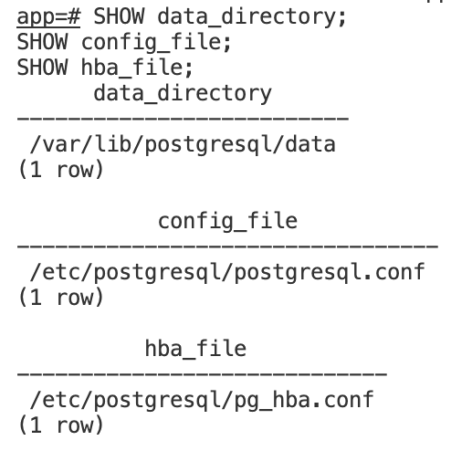
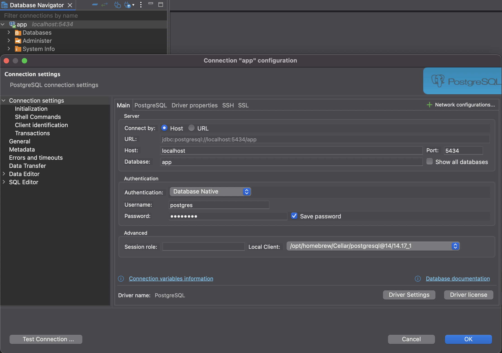
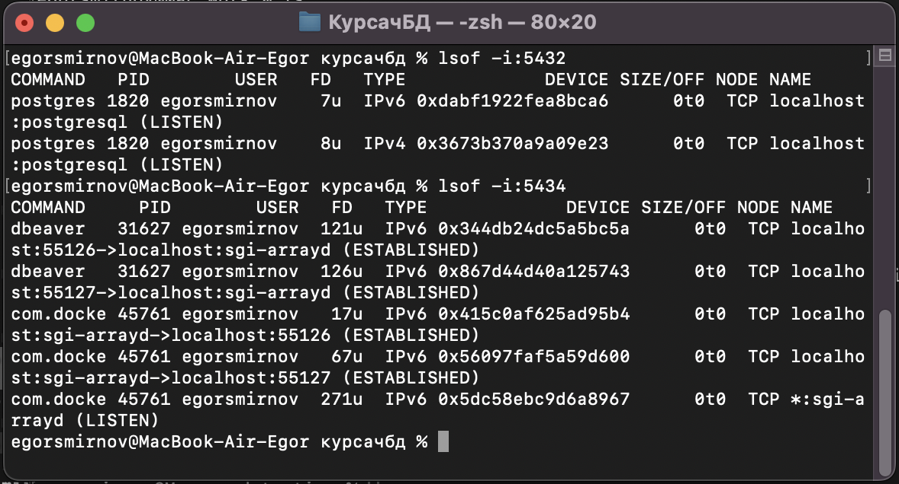

## СОДЕРЖАНИЕ
- Скриншот docker compose ps и развернутый комментарий к нему.
- Скриншот SELECT version(); и \conninfo и развернутый комментарий к нему.
- Скриншот SHOW data_directory; и развернутый комментарий к нему.
- Скриншот pgAdmin/DBeaver/Datagrip с подключением к СУБД и развернутый комментарий к нему.

---

## Скриншот docker compose ps и развернутый комментарий к нему.

Docker Compose Process Status (рисунок 1) показывает состояния процессов. Например, сервис pg-admin в образе dpage/pgadmin4:lastest (настроено в docker-compose.yml), исполненный bash-скриптом /entrypoint.sh (честно, я бы сам спросил откуда берётся /entrypoint.sh, так как его нет в официальной документации pgamdin4 - https://pgadmin-archive.postgresql.org/pgadmin4/v6.10/docs/pgadmin4-6.10.pdf [старая документация], https://www.pgadmin.org/docs/pgadmin4/latest/container_deployment.html [новая документация], как и docker-entrypoint.sh для pg-primary и pg-replica). Возможно /entrypoint.sh файл определяется в https://github.com/pgadmin-org/pgadmin4/blob/master/pkg/docker/entrypoint.sh и запускается из Dockerfile здесь https://github.com/pgadmin-org/pgadmin4/blob/master/Dockerfile. Вероятно, dockerfile-entrypoint.sh определяется в https://github.com/docker-library/postgres/blob/master/docker-entrypoint.sh и запускается, например, здесь https://github.com/docker-library/postgres/blob/master/Dockerfile-alpine.template.
Также Docker Compose Process Status пишет, сколько времени назад создался сервис, на каких портах работает.

## Скриншот SELECT version() и развернутый комментарий к нему.

"SELECT version();" (рисунок 2) показывает версию сервера. Оператор SELECT выводит грубо говоря values, возвращаемые функцией version() - https://pgpedia.info/v/version.html, архитектуру ОС и компилятор.

## Скриншот \conninfo и развернутый комментарий к нему.

Параметры подключения (рисунок 3). Особых делатей в документациях к этой функции разработчиками postgresql не приводится (https://www.postgresql.org/docs/current/libpq-connect.html), функция выводит данные о названии базы данных, под каким подключенным пользователем выводится информация о БД, сокет и порт.

## Скриншот SHOW data_directory и развернутый комментарий к нему.

Оператор SHOW данных о data_directory (рисунок 4) выводит информацию о директориях, описанных в:
- Config_file (string)
Указывает основной файл конфигурации сервера (обычно называется postgresql.conf). Этот параметр можно установить только в командной строке postgres.
Опредлеяется в
```command: ["postgres", "-c", "config_file=/etc/postgresql/postgresql.conf"]``` файла docker-compose.yml
- Hba_file (string)
Указывает файл конфигурации для аутентификации на основе хоста (обычно называется pg_hba.conf). Этот параметр можно установить только при запуске сервера.
Определяется в ```hba_file = '/etc/postgresql/pg_hba.conf'``` файла pg_hba.conf, определённого в том же docker-compose.yml
- Data_directory (string)
Указывает каталог, который будет использоваться для хранения данных. Этот параметр можно установить только при запуске сервера.
Установлена по умолчанию, к этой директории подключаются db-replica и db-primary
(https://www.postgresql.org/docs/current/runtime-config-file-locations.html)

## Скриншот pgAdmin/DBeaver/Datagrip с подключением к СУБД и развернутый комментарий к нему.

Для успешного подключения к PostgreSQL БД (рисунок 5) был сменён порт, так как на 5432 уже что-то работало (рисунок 6). В остальном настройки соответствовали параметрам подключения, определёнными в файле окружения проекта .env
